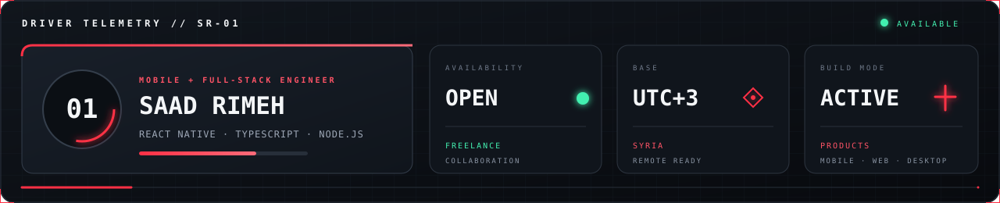
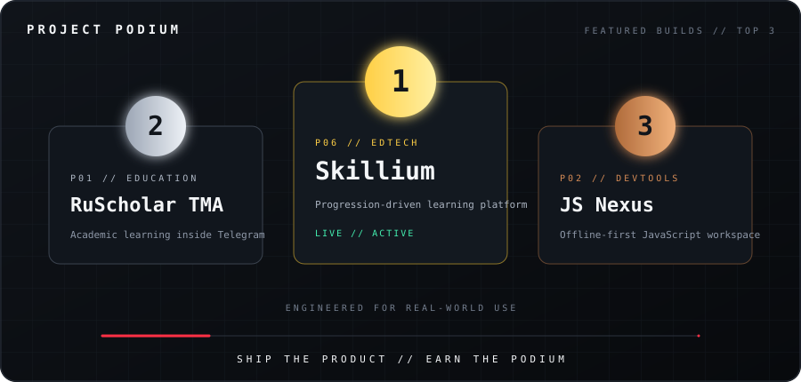
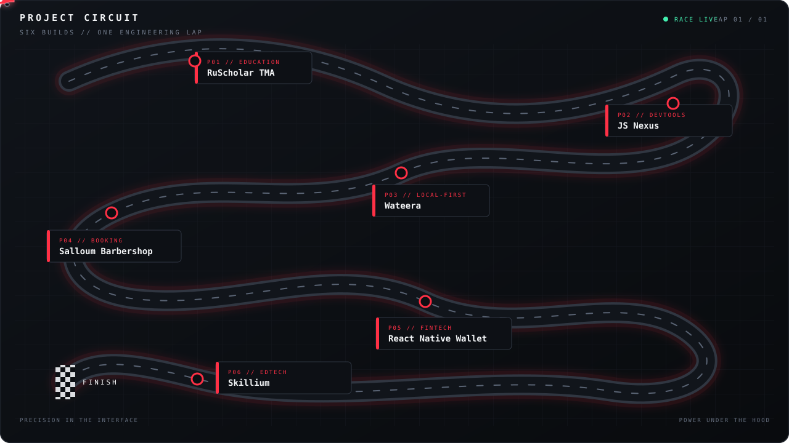

<div align="center">

<picture>
  <source media="(prefers-reduced-motion: reduce)" srcset="./assets/race-control-preview.png">
  
</picture>

<br>

[](https://saadrimeh.github.io/portfolio/)
[](https://www.linkedin.com/in/saad-rimeh)
[](mailto:saad.rimeh.01@gmail.com)

<br>

<picture>
  <source media="(prefers-reduced-motion: reduce)" srcset="./assets/lights-out-static.svg">
  
</picture>

**DRIVER 01 // MOBILE & FULL-STACK ENGINEER**

I turn product ideas into fast, focused experiences — from the first interface lap<br>
to the APIs, data models, and deployment systems running under the bodywork.

`SYRIA` &nbsp;•&nbsp; `AVAILABLE FOR FREELANCE` &nbsp;•&nbsp; `OPEN TO COLLABORATION`

</div>

<br>

<picture>
  <source media="(prefers-reduced-motion: reduce) and (max-width: 640px)" srcset="./assets/pit-board-mobile-static.svg">
  <source media="(prefers-reduced-motion: reduce)" srcset="./assets/pit-board-static.svg">
  <source media="(max-width: 640px)" srcset="./assets/pit-board-mobile.svg">
  
</picture>

<br>

## 01 / Race briefing

Great software is built like a race car: every component has a purpose, every millisecond matters, and the whole system must perform when the pressure is on.

I'm **Saad Rimeh**, a mobile and full-stack developer focused on useful products with polished interfaces and dependable engineering. I enjoy owning the full lap — product thinking, UI implementation, API architecture, data modeling, and delivery.

- **Mobile engineering** — cross-platform applications with React Native, Expo, and TypeScript.
- **Full-stack systems** — React interfaces backed by Node.js, Express, PostgreSQL, and MongoDB.
- **Independent R&D** — local-first software, offline AI, and desktop developer tools.
- **Product craft** — practical solutions for education, productivity, and personal finance.

<br>

<picture>
  <source media="(prefers-reduced-motion: reduce)" srcset="./assets/telemetry-static.svg">
  
</picture>

<br>

## 02 / Car setup

<div align="center">


</div>

<br>


## 03 / Starting grid

<div align="center">

### Featured podium

<picture>
  <source media="(prefers-reduced-motion: reduce)" srcset="./assets/project-podium-static.svg">
  
</picture>

[](https://portfolio-lime-eight-cb5c5ameei.vercel.app/)
[](https://github.com/SaadRimeh/skillium-showcase)
[](https://ru-scholar-tma.vercel.app)
[](https://github.com/SaadRimeh/Js-Nexus)

<br>

### Full project circuit

<picture>
  <source media="(prefers-reduced-motion: reduce) and (max-width: 640px)" srcset="./assets/project-circuit-mobile-static.svg">
  <source media="(prefers-reduced-motion: reduce)" srcset="./assets/project-circuit-static.svg">
  <source media="(max-width: 640px)" srcset="./assets/project-circuit-mobile.svg">
  
</picture>

<sub>FOLLOW THE CAR // EACH CHECKPOINT IS A SHIPPED PRODUCT</sub>

</div>

<br>

### `P01` &nbsp; RuScholar TMA

> **Helping international students navigate academic life in Russia.**

An academic translation and learning platform delivered through a Telegram bot and Mini App. Contextual translation, terminology extraction, and spaced repetition come together in one focused study workflow.

`TypeScript` `React` `Node.js` `Express` `MongoDB` `Telegram Mini Apps` `Docker`

<details>
<summary><strong>CASE STUDY // ACADEMIC ACCESS</strong></summary>
<br>

**Problem** — international students need translation and study tools inside the communication channel they already use.<br>
**Role** — full-stack product engineering across the learning interface, API, and data workflow.<br>
**Key decision** — combine a Telegram bot with a Mini App so quick actions and richer study sessions share one system.<br>
**Status** — live demo and public repository available.

</details>

[**VIEW REPOSITORY ↗**](https://github.com/SaadRimeh/RuScholar-TMA) &nbsp;·&nbsp; [**LIVE APP ↗**](https://ru-scholar-tma.vercel.app)

---

### `P02` &nbsp; JS Nexus

> **A JavaScript workspace designed to keep working offline.**

An offline-first desktop IDE with Monaco Editor, dual execution modes, an embedded terminal, Git integration, an event-loop visualizer, and a local assistant powered by Ollama.

`Electron` `React` `Monaco Editor` `TypeScript` `Ollama` `Vite`

<details>
<summary><strong>CASE STUDY // OFFLINE DEVELOPMENT</strong></summary>
<br>

**Problem** — browser-based coding tools lose their value when the network disappears or private code must stay local.<br>
**Role** — desktop product engineering across editor, execution, terminal, Git, and assistant workflows.<br>
**Key decision** — make offline execution the default and integrate Ollama locally instead of depending on a hosted AI service.<br>
**Status** — public repository available.

</details>

[**VIEW REPOSITORY ↗**](https://github.com/SaadRimeh/Js-Nexus)

---

### `P03` &nbsp; Wateera

> **One private space for the routines that move life forward.**

A local-first personal operating system that brings tasks, study planning, fitness, career goals, medication routines, and finance tracking into one mobile experience.

`React Native` `Expo` `TypeScript` `Expo Router` `Local-first`

<details>
<summary><strong>CASE STUDY // PERSONAL OPERATING SYSTEM</strong></summary>
<br>

**Problem** — personal routines become fragmented across disconnected productivity, health, study, and finance apps.<br>
**Role** — mobile product architecture and implementation for one coordinated daily system.<br>
**Key decision** — keep the experience local-first so private routines remain fast, resilient, and user-controlled.<br>
**Status** — public repository available.

</details>

[**VIEW REPOSITORY ↗**](https://github.com/SaadRimeh/Wateera)

---

### `P04` &nbsp; Salloum Barbershop

> **A bilingual booking experience built around everyday convenience.**

An Arabic/English mobile app for appointments and product reservations, with authentication, dark mode, and complete RTL/LTR layout support.

`React Native` `Expo` `TypeScript` `Clerk` `REST API` `i18n`

<details>
<summary><strong>CASE STUDY // BILINGUAL BOOKING</strong></summary>
<br>

**Problem** — appointment and product reservation flows must feel natural in both Arabic and English.<br>
**Role** — cross-platform mobile engineering across authentication, booking, catalog, and localization.<br>
**Key decision** — design RTL and LTR behavior as a core layout constraint rather than a late translation layer.<br>
**Status** — live demo and public repository available.

</details>

[**VIEW REPOSITORY ↗**](https://github.com/SaadRimeh/SaloumApp) &nbsp;·&nbsp; [**LIVE APP ↗**](https://saloum.onrender.com)

---

### `P05` &nbsp; React Native Wallet

> **A clearer view of personal finances, across devices.**

A full-stack finance app for tracking income, expenses, categories, and account summaries across iOS, Android, and web.

`React Native` `Expo` `Node.js` `Express` `PostgreSQL` `Clerk`

<details>
<summary><strong>CASE STUDY // CROSS-PLATFORM FINANCE</strong></summary>
<br>

**Problem** — users need one consistent view of income and expenses across mobile and web.<br>
**Role** — full-stack engineering across transaction flows, authentication, API design, and relational data.<br>
**Key decision** — share the product model across platforms while keeping the backend responsible for trusted financial summaries.<br>
**Status** — public repository available.

</details>

[**VIEW REPOSITORY ↗**](https://github.com/SaadRimeh/React-Native-wallet)

---

### `P06` &nbsp; Skillium

> **Learning, structured for progress.**

A full-featured educational platform for managing academic content, courses, lectures, assessments, and student–tutor meetings through multi-role authorization. Sequential learning rules control lesson access based on exam outcomes, with retry workflows after failed results, secure private meeting links for every student, and documented REST APIs supporting web, mobile, and administrative applications.

`Multi-role Authorization` `Sequential Learning` `Assessments` `Retry Workflows` `Private Meetings` `REST APIs`

<details>
<summary><strong>CASE STUDY // PROGRESSION-DRIVEN LEARNING</strong></summary>
<br>

**Problem** — publishing lessons is not enough; access must respond to assessment results and student progress.<br>
**Role** — end-to-end platform engineering across roles, academic content, assessments, meetings, and REST APIs.<br>
**Key decision** — model lesson availability as progression state, with passed exams unlocking the next step and failed attempts activating a retry workflow.<br>
**Status** — live platform; production source private; public showcase available.

</details>

[**VIEW SHOWCASE ↗**](https://github.com/SaadRimeh/skillium-showcase) &nbsp;·&nbsp; [**LIVE PLATFORM ↗**](https://portfolio-lime-eight-cb5c5ameei.vercel.app/)

<br>


## 04 / Pit wall

```text
CURRENT MISSION   Build thoughtful products that earn their place on a user's screen.
ENGINE MODE       TypeScript-first · Mobile-minded · Full-stack capable.
RACE STRATEGY     Make it useful. Make it reliable. Then make it feel exceptional.
NEXT SESSION      Your idea could be on the grid.
```

<div align="center">

### Have a product worth racing?

[](mailto:saad.rimeh.01@gmail.com)

<sub>ENGINEERED WITH PRECISION // BUILT TO SHIP</sub>

</div>
