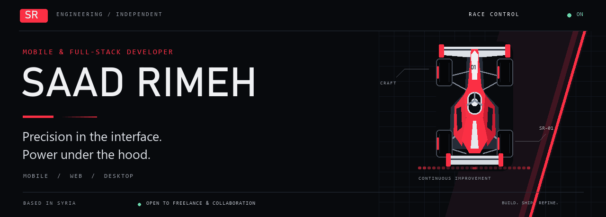
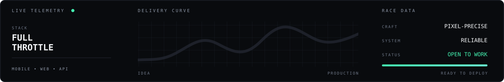

<div align="center">



<br>

[](https://saadrimeh.github.io/portfolio/)
[](https://www.linkedin.com/in/saad-rimeh)
[](mailto:saad.rimeh.01@gmail.com)

<br>



**DRIVER 01 // MOBILE & FULL-STACK ENGINEER**

I turn product ideas into fast, focused experiences — from the first interface lap<br>
to the APIs, data models, and deployment systems running under the bodywork.

`SYRIA` &nbsp;•&nbsp; `AVAILABLE FOR FREELANCE` &nbsp;•&nbsp; `OPEN TO COLLABORATION`

</div>

<br>

## 01 / Race briefing

Great software is built like a race car: every component has a purpose, every millisecond matters, and the whole system must perform when the pressure is on.

I'm **Saad Rimeh**, a mobile and full-stack developer focused on useful products with polished interfaces and dependable engineering. I enjoy owning the full lap — product thinking, UI implementation, API architecture, data modeling, and delivery.

- **Mobile engineering** — cross-platform applications with React Native, Expo, and TypeScript.
- **Full-stack systems** — React interfaces backed by Node.js, Express, PostgreSQL, and MongoDB.
- **Independent R&D** — local-first software, offline AI, and desktop developer tools.
- **Product craft** — practical solutions for education, productivity, and personal finance.

<br>



<br>

## 02 / Car setup

<div align="center">


</div>

<br>


## 03 / Starting grid

### `P01` &nbsp; RuScholar TMA

> **Helping international students navigate academic life in Russia.**

An academic translation and learning platform delivered through a Telegram bot and Mini App. Contextual translation, terminology extraction, and spaced repetition come together in one focused study workflow.

`TypeScript` `React` `Node.js` `Express` `MongoDB` `Telegram Mini Apps` `Docker`

[**VIEW REPOSITORY ↗**](https://github.com/SaadRimeh/RuScholar-TMA) &nbsp;·&nbsp; [**LIVE APP ↗**](https://ru-scholar-tma.vercel.app)

---

### `P02` &nbsp; JS Nexus

> **A JavaScript workspace designed to keep working offline.**

An offline-first desktop IDE with Monaco Editor, dual execution modes, an embedded terminal, Git integration, an event-loop visualizer, and a local assistant powered by Ollama.

`Electron` `React` `Monaco Editor` `TypeScript` `Ollama` `Vite`

[**VIEW REPOSITORY ↗**](https://github.com/SaadRimeh/Js-Nexus)

---

### `P03` &nbsp; Wateera

> **One private space for the routines that move life forward.**

A local-first personal operating system that brings tasks, study planning, fitness, career goals, medication routines, and finance tracking into one mobile experience.

`React Native` `Expo` `TypeScript` `Expo Router` `Local-first`

[**VIEW REPOSITORY ↗**](https://github.com/SaadRimeh/Wateera)

---

### `P04` &nbsp; Salloum Barbershop

> **A bilingual booking experience built around everyday convenience.**

An Arabic/English mobile app for appointments and product reservations, with authentication, dark mode, and complete RTL/LTR layout support.

`React Native` `Expo` `TypeScript` `Clerk` `REST API` `i18n`

[**VIEW REPOSITORY ↗**](https://github.com/SaadRimeh/SaloumApp) &nbsp;·&nbsp; [**LIVE APP ↗**](https://saloum.onrender.com)

---

### `P05` &nbsp; React Native Wallet

> **A clearer view of personal finances, across devices.**

A full-stack finance app for tracking income, expenses, categories, and account summaries across iOS, Android, and web.

`React Native` `Expo` `Node.js` `Express` `PostgreSQL` `Clerk`

[**VIEW REPOSITORY ↗**](https://github.com/SaadRimeh/React-Native-wallet)

<br>


## 04 / Pit wall

```text
CURRENT MISSION   Build thoughtful products that earn their place on a user's screen.
ENGINE MODE       TypeScript-first · Mobile-minded · Full-stack capable.
RACE STRATEGY     Make it useful. Make it reliable. Then make it feel exceptional.
NEXT SESSION      Your idea could be on the grid.
```

<div align="center">

### Have a product worth racing?

[](mailto:saad.rimeh.01@gmail.com)

<sub>ENGINEERED WITH PRECISION // BUILT TO SHIP</sub>

</div>
